# Forgeway

> **This is a showcase copy of a private repository**, published to show the platform
> engineering: backend, grader and sandbox, frontend, deployment and operations, docs and ADRs.
> The live product is at **[forgeway.dev](https://forgeway.dev)**. Because it has a paid tier,
> this copy omits, for every exercise outside the foundations track: the reference solutions,
> the hidden tests, the wrong answers and the hints, and in the guided projects the starter
> files that would be the previous milestone's solution. The grader-side reference
> implementations those hidden tests used (and their tests) are omitted too. The foundations
> track is complete, so you can see how content proves itself. All 91 briefs and starters are
> here and the whole map loads locally, but only the foundations can be graded: submitting any
> other exercise fails with a message saying so (see [content/SHOWCASE.md](content/SHOWCASE.md)).
> The history is a single commit.

**Hands-on, automatically graded challenges for modern AI engineering**: prompting, token
budgets, retries, structured output and tool calling; chunking, vector and hybrid search,
reranking and agentic RAG; MCP servers and clients built at the wire level; agent
orchestration (routing, fan-out, handoffs, human-in-the-loop, checkpointing); knowledge graphs;
agent memory; context engineering; and evals and guardrails. Every track ends in a capstone
project, and two guided projects tie the tracks together into a support copilot and a research
agent team.

Most courses in this space stop at tutorials. In Forgeway you write the code, and a sandboxed
grader checks how it *behaves*: which chunks your retriever returns, what actually reached the
model's prompt, whether your client backs off on a rate limit and gives up on a bad request.
The same engine is presented two ways: an **RPG mode** (zones, quests, levels, a level-up seal)
and a calm **professional mode** for teams (tracks, exercises, progress). Switching mode
changes the skin, never the content or the grading.

> Status: Phases 1–4 are built: a foundations track, seven tracks that each close with a
> capstone, two guided projects (91 exercises), classes and talents, badges, streaks, shareable
> certificates, a free plan with a Pro waitlist, and in-app release notes. It runs at
> [forgeway.dev](https://forgeway.dev), behind a password until public sign-up opens. See the
> [roadmap](#roadmap).

| Professional mode | RPG mode |
| --- | --- |
| 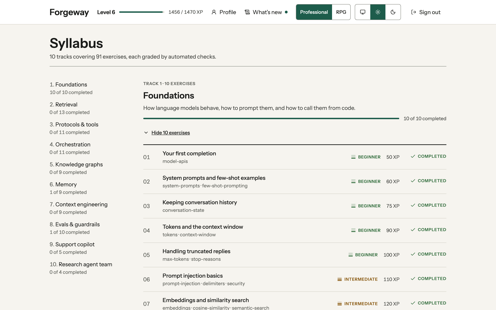 | 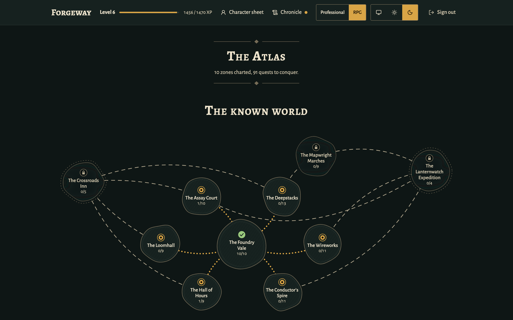 |
| 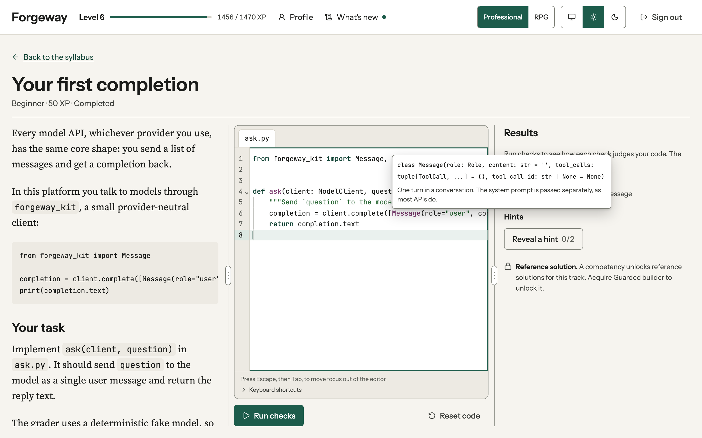 | 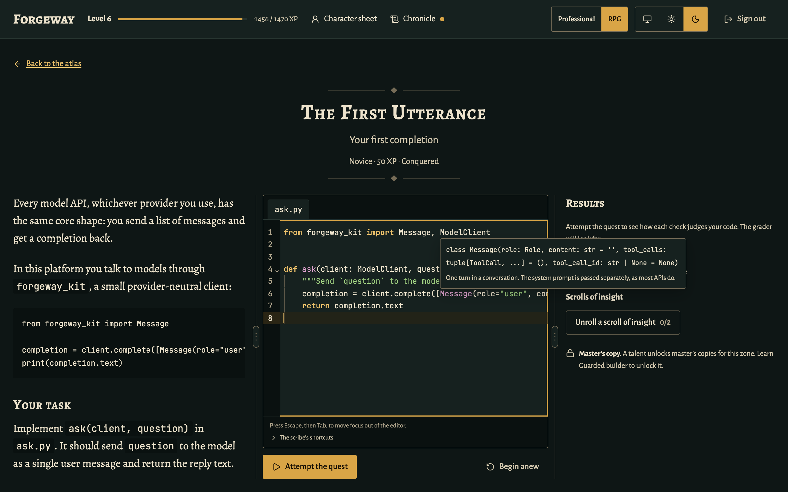 |
| 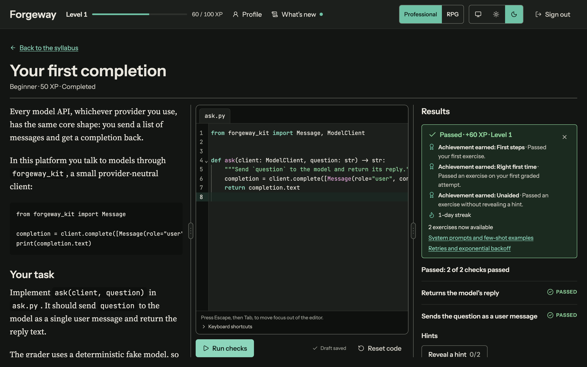 | 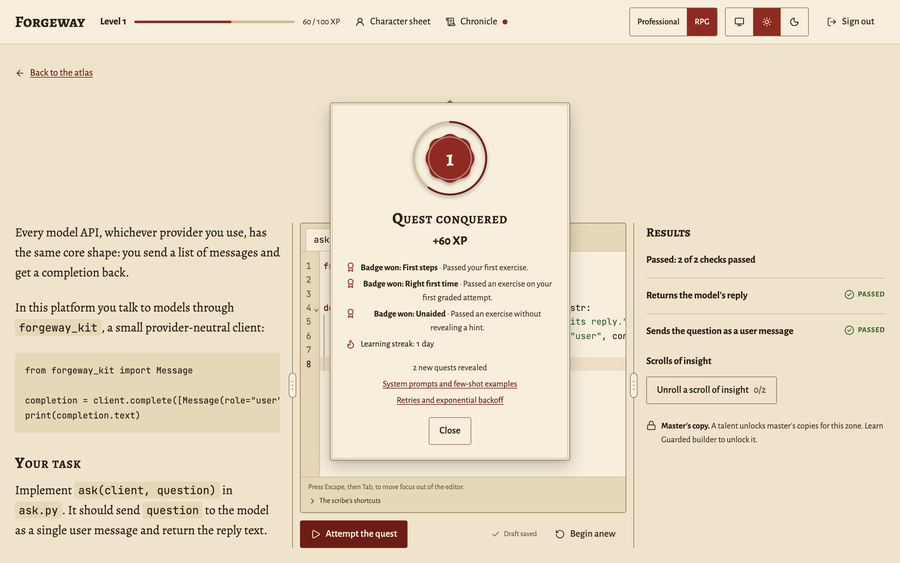 |
| 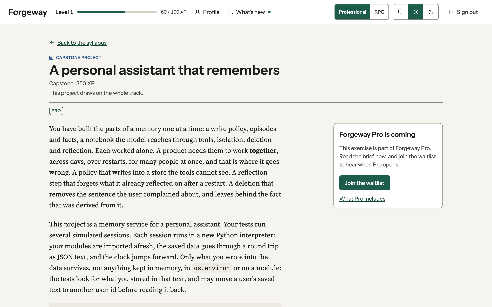 | 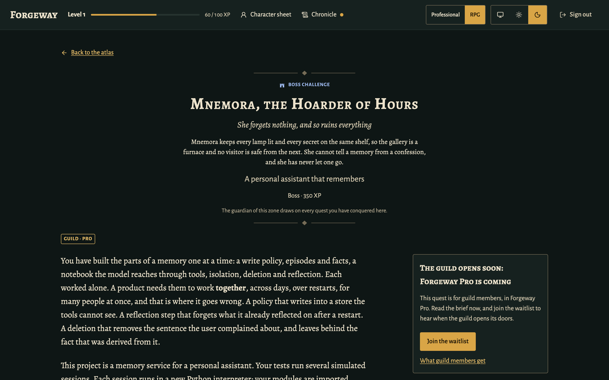 |
| 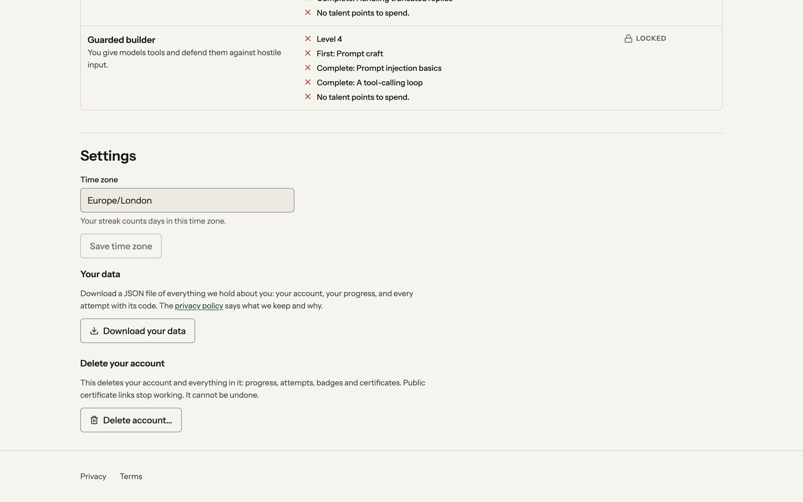 | 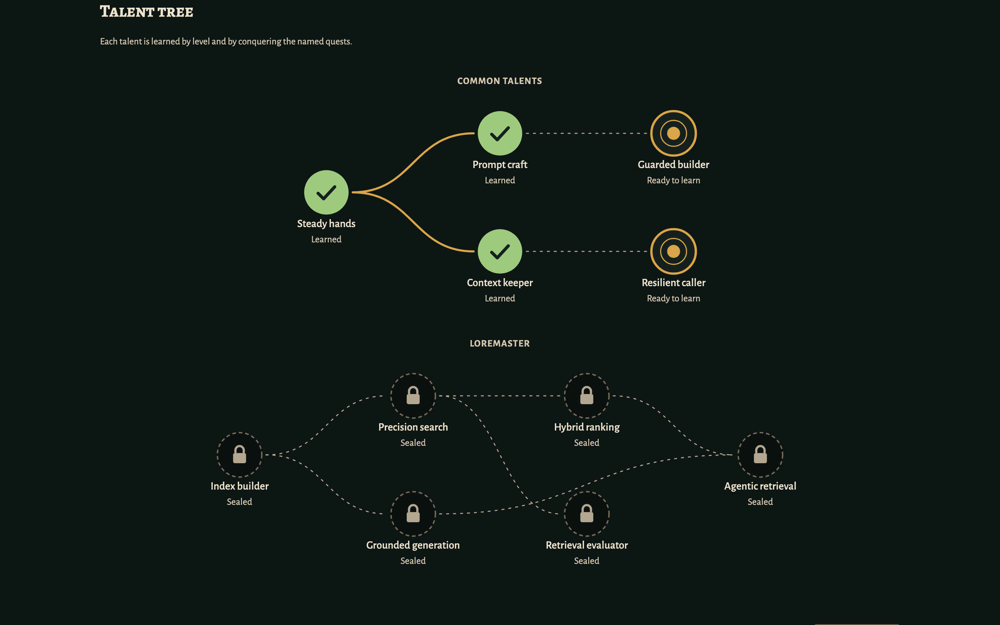 |

Same content, same grading, same progress — only the skin changes. Both modes have light and
dark palettes, work down to phone width ([RPG](docs/screenshots/phase-4/rpg-dark-mobile.png), [professional](docs/screenshots/phase-4/professional-light-mobile.png)) and
are scanned with axe in CI.

## What is interesting here

- **Behavioural grading of AI code, deterministically.** Learner code talks to models through
  `forgeway_kit`, a small provider-neutral client. In the sandbox it is a deterministic,
  recording fake, so checks can assert on *what the code sent* and *how it reacted*, for free
  and reproducibly. The same call returns a real, proxied client in live mode, so exercises
  never change. ([ADR 0003](docs/adr/0003-pytest-grading-and-sandbox.md))
- **A real sandbox for untrusted code.** Each attempt runs in a throwaway container with no
  network, a read-only root, a size-capped tmpfs, learner code as a non-root user with no
  capabilities (a second user, unable to read the hidden tests, for out-of-process exercises),
  and memory, CPU, process and wall-clock limits. Files are streamed in on stdin; nothing is
  mounted.
  Infinite loops, fork bombs, memory bombs, output floods, network calls and forged reports
  each have a test. The limits of in-process grading are written down honestly rather than
  hidden.
- **Content that proves itself.** Every exercise ships a reference solution and a set of
  realistic *wrong* solutions, each declaring which check it must fail and what the learner
  must be told. CI grades all of them for real on every push: in the product, 91 solutions pass
  and 521 wrong answers fail with the expected message (this showcase keeps the foundations'
  10 solutions and 30 wrong answers, which its CI grades the same way). Every track, capstone and project was then attacked
  by an independent reviewer trying to pass without doing the work; every proven cheat became a
  permanent wrong answer, and recurring patterns became platform fixes (the fake model records
  only what the wire would carry; restarts run in a genuinely fresh interpreter).
- **Capstones and guided projects.** Each track closes with a multi-file capstone (a *boss
  challenge* in RPG mode) whose checks cover how the parts work together, so pasting the earlier
  solutions side by side fails. Two guided projects then build one codebase across several
  milestones, each opening with the learner's own code from the milestone before.
  ([ADR 0007](docs/adr/0007-capstones.md))
- **MCP taught at the wire level, and proven against the real thing.** Learners implement the
  handshake, tools, resources, prompts, pagination and stdio framing themselves. The grader's
  reference implementation is tested against the official Python SDK in both directions and
  every message is validated against the specification's JSON schema (that reference and its
  interop tests are not part of this showcase). ([ADR 0005](docs/adr/0005-mcp-at-the-wire-level.md))
- **A theme-agnostic domain.** The domain never says "quest" or "zone"; an
  [import-linter](pyproject.toml) contract enforces that it imports nothing outward. Themes are
  tokens, a typed vocabulary and a handful of named layout slots.
  ([ADR 0004](docs/adr/0004-theme-system.md))
- **Progress that rewards learning, not visits.** XP comes from an append-only ledger, once per
  exercise on first pass, with a bonus for solving without hints. Levels are derived from it,
  never stored. Grading and its progression effects are committed in one transaction and the
  ledger's unique key makes double awards impossible. Talents recognise demonstrated skill but
  never touch scoring (free respecs would make any bonus exploitable); streaks count days with
  graded work in the learner's own time zone, stamped at submission so a later zone change
  cannot rewrite history. ([ADR 0006](docs/adr/0006-progression.md))
- **Certificates you can verify.** Finishing a track issues a certificate. Once the learner makes
  it public it has a server-rendered verification page with OpenGraph tags and a generated
  1200×627 image, plus one-click *Add to LinkedIn profile* and *Share* links. Nothing about the
  account beyond the chosen name is exposed.
  ([preview](docs/screenshots/phase-4/certificate-linkedin-preview.png))

## Architecture

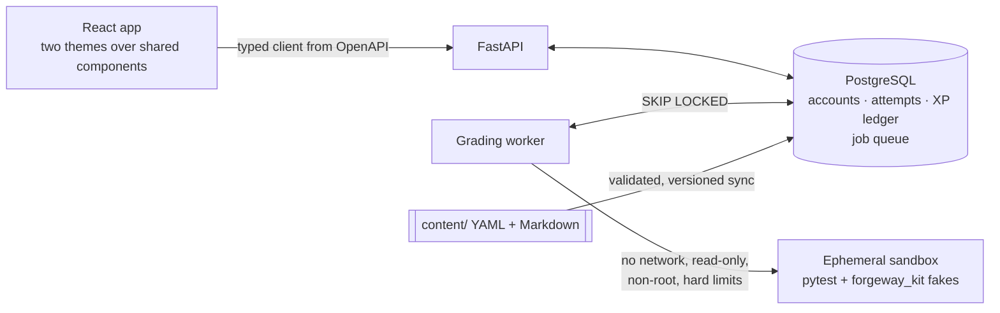

A modular monolith: the API and the worker are two entrypoints over one codebase, layered
`api/worker → application → infrastructure → domain`. Postgres is also the job queue
(`SELECT … FOR UPDATE SKIP LOCKED`), which keeps enqueueing transactional with the attempt
and removes a moving part. Full details: [docs/ARCHITECTURE.md](docs/ARCHITECTURE.md) and the
[ADRs](docs/adr/).

| Layer | Stack |
| --- | --- |
| API and worker | Python 3.12, FastAPI, Pydantic v2, SQLAlchemy 2, Alembic, PostgreSQL 17 |
| Grader | Docker, pytest with a custom reporting plugin, `forgeway_kit` |
| Frontend | TypeScript (strict), React, Vite, Tailwind on semantic tokens, TanStack Router and Query, CodeMirror 6 |
| Quality | pytest + Hypothesis, Vitest + Testing Library, Playwright, ruff, mypy `--strict`, ESLint, import-linter, pre-commit, GitHub Actions |

## Run it locally

You need Docker (with Compose) — nothing else.

```bash
git clone https://github.com/tomtomsatnav/forgeway-showcase.git && cd forgeway-showcase
docker compose up --build
```

Then open http://localhost:8080 and sign in as the demo learner
(`demo@forgeway.dev` / `forgeway-demo-password`), who has finished the foundations, or
register a new account. The API's interactive docs are at http://localhost:8000/docs.

For development, with [uv](https://docs.astral.sh/uv/) and Node 22:

```bash
make install            # Python and frontend dependencies
docker compose up -d db # Postgres only
make check              # lint, strict types, layering, unit, sandbox and foundations content tests
cd frontend && npm run dev
```

## Add an exercise

An exercise is a directory of plain files — no platform code changes:

```
content/branches/retrieval/exercises/fixed-size-chunking/
├── exercise.yaml   checks, hints, XP, tier, prerequisites
├── brief.md        what the learner reads
├── starter/        the files they edit
├── tests/          hidden pytest checks with learner-facing messages
├── solution/       must pass
└── wrong/<case>/   a realistic mistake that must fail a named check
```

```bash
uv run forgeway content validate                       # schema, files, prerequisite graph
uv run forgeway content test --only starter.first      # grade solution and wrong cases for real
```

The full guide, including how to write checks that cannot be gamed, is in
[docs/authoring.md](docs/authoring.md).

## Roadmap

| Phase | Scope | Status |
| --- | --- | --- |
| 1 | Engine and grader, starter zone, Retrieval branch, XP, levels, unlocks, both modes | Done — [verification](docs/phase-1-verification.md) |
| 2 | Protocols & tools (MCP servers and clients) and Orchestration branches; talent tree and classes; badges and streaks; shareable certificates (brought forward from Phase 4) | Done — [verification](docs/phase-2-verification.md) |
| 3 | Knowledge graphs, Memory, Context engineering, Evals & guardrails; boss challenges and capstones; two guided projects | Done — [verification](docs/phase-3-verification.md) |
| 4 | Launch: safe public sign-up, a free plan and Pro waitlist, release notes, authoring tooling, out-of-process learner code, privacy and account data tools, deployment on a single VPS (Docker, gVisor sandboxes behind a socket-proxy, Caddy and Cloudflare). Organisations, leaderboards, signed certificates, live-model grading and Terraform are deferred by the owner. | Done — [verification](docs/phase-4-verification.md); public sign-up waits on the owner's launch steps |

## Repository map

```
backend/   FastAPI app, worker, domain, persistence, Alembic migrations, tests
grader/    forgeway_kit (learner toolkit), lattice_grader (in-sandbox harness), sandbox image
content/   branches, exercises and theme flavour
frontend/  React app
docs/      architecture, ADRs, authoring guide
```
