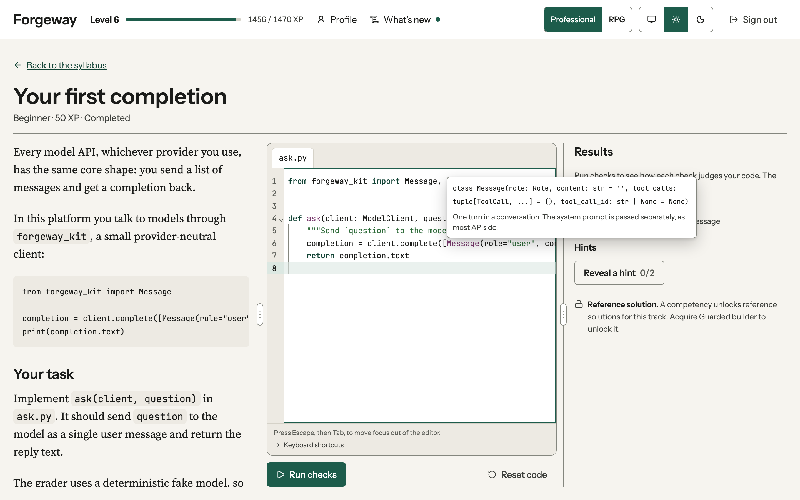
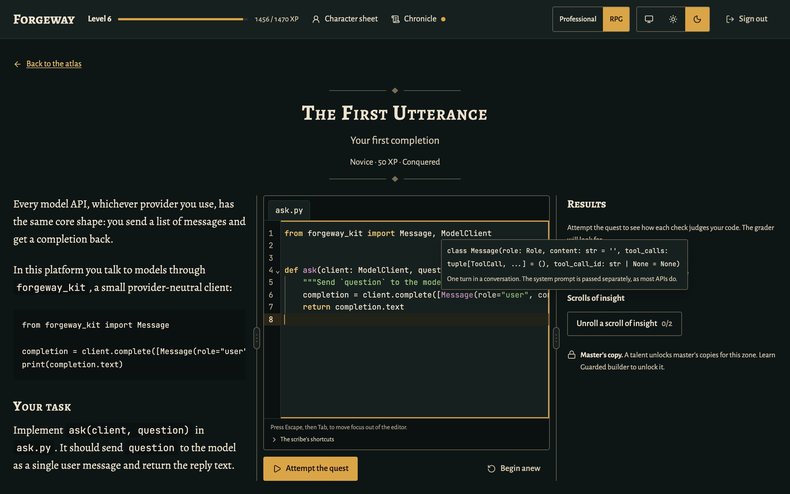
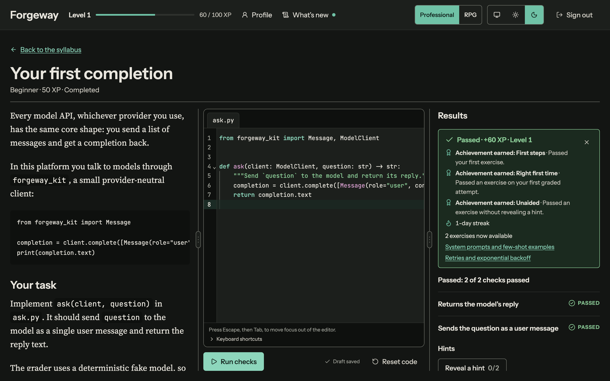
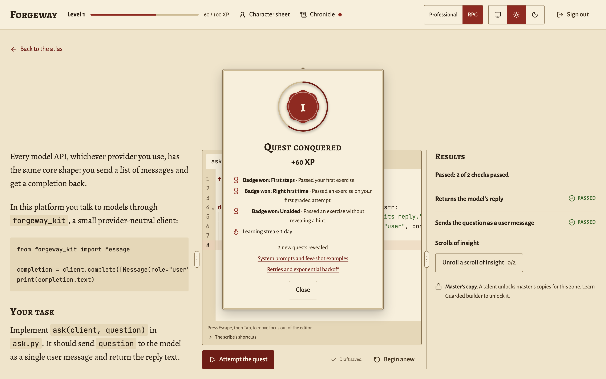

# Forgeway

> **This is a public showcase of a private repository**, published to show the platform
> engineering: backend, grader and sandbox, frontend, deployment and docs. **It is a free subset.**
> It holds the platform code plus only what a free learner can use: 39 exercises across
> 9 tracks. The full course, with every capstone and guided project, lives at
> **[forgeway.dev](https://forgeway.dev)**.
>
> The foundations and the Python primer are complete here, with hidden tests, reference solutions
> and wrong answers, so you can see how content proves itself. The other free exercises keep their
> briefs and starters, but can only be graded on the live site (see
> [content/SHOWCASE.md](content/SHOWCASE.md)). The history is a single commit.

**Hands-on, automatically graded challenges for modern AI engineering.** In Forgeway you write the
code, and a sandboxed grader checks how it *behaves*: which chunks your retriever returns, what
actually reached the model's prompt, whether your client backs off on a rate limit and gives up on
a bad request. The same engine is presented two ways: an **RPG mode** (zones, quests, levels, a
level-up seal) and a calm **professional mode** for teams (tracks, exercises, progress). Switching
mode changes the skin, never the content or the grading.

| Professional mode | RPG mode |
| --- | --- |
|  |  |
|  |  |

## What is interesting here

- **Behavioural grading of AI code, deterministically.** Learner code talks to models through
  `forgeway_kit`, a small provider-neutral client. In the sandbox it is a deterministic, recording
  fake, so checks can assert on *what the code sent* and *how it reacted*, for free and
  reproducibly. The same call returns a real, proxied client in live mode, so exercises never
  change. ([ADR 0003](docs/adr/0003-pytest-grading-and-sandbox.md))
- **A real sandbox for untrusted code.** Each attempt runs in a throwaway container with no
  network, a read-only root, a size-capped tmpfs, learner code as a non-root user with no
  capabilities, and memory, CPU, process and wall-clock limits. Files are streamed in on stdin;
  nothing is mounted. Infinite loops, fork bombs, memory bombs, output floods, network calls and
  forged reports each have a test.
- **Content that proves itself.** An exercise ships a reference solution and realistic *wrong*
  solutions, each declaring which check it must fail and what the learner must be told. CI grades
  them for real on every push: here, 18 solutions must pass and 65 wrong answers must
  fail with the expected message.
- **A theme-agnostic domain.** The domain never says "quest" or "zone"; an
  [import-linter](pyproject.toml) contract enforces that it imports nothing outward. Themes are
  tokens, a typed vocabulary and a handful of named layout slots.
  ([ADR 0004](docs/adr/0004-theme-system.md))
- **Progress that rewards learning, not visits.** XP comes from an append-only ledger, once per
  exercise on first pass. Levels are derived from it, never stored, and the ledger's unique key
  makes double awards impossible. ([ADR 0006](docs/adr/0006-progression.md))
- **Certificates you can verify.** Finishing a track issues a certificate with a server-rendered
  verification page and a generated image.
  ([preview](docs/screenshots/phase-4/certificate-linkedin-preview.png))

## Architecture

A modular monolith: the API and the worker are two entrypoints over one codebase, layered
`api/worker -> application -> infrastructure -> domain`. Postgres is also the job queue
(`SELECT ... FOR UPDATE SKIP LOCKED`), which keeps enqueueing transactional with the attempt.
Details: [docs/ARCHITECTURE.md](docs/ARCHITECTURE.md) and the [ADRs](docs/adr/). The ADRs and the
docs describe the full product, so they mention capstones and guided projects that are not in this
copy.

| Layer | Stack |
| --- | --- |
| API and worker | Python 3.12, FastAPI, Pydantic v2, SQLAlchemy 2, Alembic, PostgreSQL 17 |
| Grader | Docker, pytest with a custom reporting plugin, `forgeway_kit` |
| Frontend | TypeScript (strict), React, Vite, Tailwind on semantic tokens, TanStack Router and Query, CodeMirror 6 |
| Quality | pytest + Hypothesis, Vitest + Testing Library, Playwright, ruff, mypy `--strict`, ESLint, import-linter, pre-commit, GitHub Actions |

## Run it locally

You need Docker (with Compose) and nothing else:

```bash
docker compose up --build
```

Then open http://localhost:8080 and sign in as the demo learner
(`demo@forgeway.dev` / `forgeway-demo-password`), who has finished the foundations, or register a
new account. For development, with [uv](https://docs.astral.sh/uv/) and Node 22:

```bash
make install            # Python and frontend dependencies
docker compose up -d db # Postgres only
make check              # lint, strict types, layering, unit, sandbox and content tests
cd frontend && npm run dev
```

## Add an exercise

An exercise is a directory of plain files, with no platform code changes. The full guide is in
[docs/authoring.md](docs/authoring.md).

```bash
uv run forgeway content validate                       # schema, files, prerequisite graph
uv run forgeway content test --only starter.first      # grade solution and wrong cases for real
```

## Repository map

```
backend/   FastAPI app, worker, domain, persistence, Alembic migrations, tests
grader/    forgeway_kit (learner toolkit), lattice_grader (in-sandbox harness), sandbox image
content/   branches, the free exercises and theme flavour
frontend/  React app
docs/      architecture, ADRs, authoring guide
```
