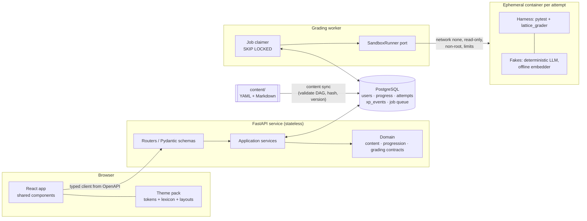
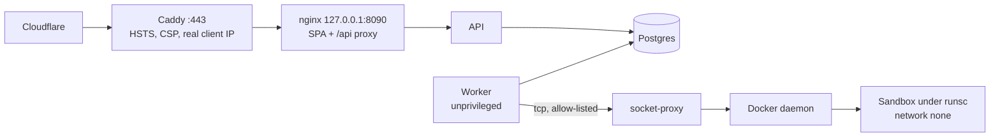
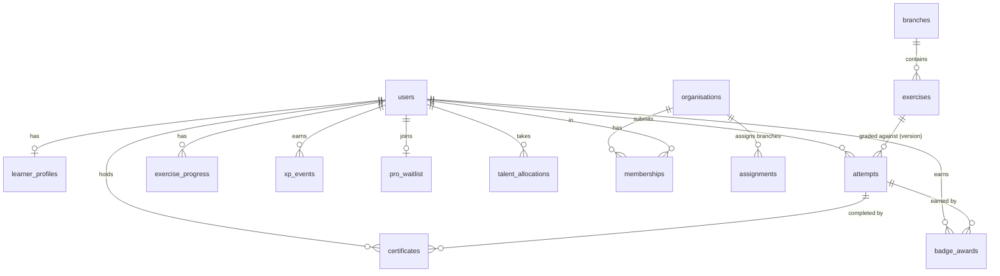

# Architecture

Forgeway is a gamified learning platform for modern AI engineering (RAG, MCP, orchestration,
agent memory, evals). Learners solve hands-on challenges that are graded automatically, including
behavioural grading of AI systems, in one of two presentation modes: an RPG mode with zones, quests
and bosses, and a professional mode with tracks, exercises and certificates.

This document describes the architecture of the **finished** product. The build is phased (see
the [phase plans](plans/); the top-level `PLAN.md` is not part of this showcase); everything here
is designed up front so later phases are additive.

## 1. The core idea

One **theme-agnostic engine** (content, grading, progression) and **themes as pure data and skins**
on top. The domain never says "quest", "zone" or "boss"; it knows `Branch`, `Exercise`, `Tier`,
`Capstone`, `Path` and `Badge`. A theme maps those to vocabulary, visuals and layout variants.

| Domain concept               | RPG mode                          | Professional mode       |
| ---------------------------- | --------------------------------- | ----------------------- |
| Branch                       | Zone                              | Track                   |
| Exercise                     | Quest                             | Exercise                |
| Capstone                     | Boss challenge                    | Capstone project        |
| Path (generalist/specialisation) | Class (Wayfarer, Loremaster)  | Specialisation          |
| Talent tree                  | Constellation of talents          | Competency matrix       |
| Badge                        | Achievement                       | Badge / certificate     |
| Level                        | Level                             | Proficiency band        |

Adding or changing a theme never touches exercise or grading code.

## 2. System overview



**In production** it all runs on one shared VPS under Docker Compose (ADR 0010). Cloudflare
proxies the site to the system Caddy, which terminates TLS and forwards to nginx on localhost.
nginx serves the SPA and proxies `/api` to the API. The worker reaches Docker only through a
socket-proxy that allows the sandbox runner's few calls, and every sandbox runs under gVisor
(`runsc`). Deploys, backups and health checks are scripts in `deploy/vps/`.



It is a **modular monolith**: the API and the grading worker are two entrypoints over one codebase.
Ports (`SandboxRunner`, `JobQueue`, repositories) keep it splittable without making it distributed
before it needs to be.

## 3. Layering

```
backend/src/lattice/
├── domain/          pure Python — no FastAPI, SQLAlchemy or theme imports
│   ├── content/     Branch, Exercise, Tier, PrerequisiteGraph
│   ├── progression/ XP rules, level curve, paths, talents, badges, streaks
│   └── grading/     GradeReport, CheckResult, SandboxRunner protocol
├── application/     use cases orchestrating domain objects and ports
├── infrastructure/  SQLAlchemy repositories, content loader, sandbox runners
├── api/             routers, request/response schemas, auth, dependency wiring
└── worker/          grading worker entrypoint
```

Dependencies point inwards only: `api → application → domain`, with `infrastructure` implementing
domain ports. An import-linter contract in CI enforces this.

## 4. Content model

Exercises live in git as declarative YAML plus Markdown:

```
content/branches/<branch>/
├── branch.yaml
└── exercises/<slug>/
    ├── exercise.yaml   metadata, checks, hints, XP, prerequisites
    ├── brief.md        learner-facing description
    ├── starter/        files the learner edits
    ├── tests/          grading tests (never served to the learner)
    ├── solution/       reference solution (never served)
    └── wrong/<case>/   known-wrong solutions + the check they must fail
```

Every exercise is graded in CI against its reference solution (must pass) and every `wrong/` case
(must fail the named check with a helpful message). That makes "every exercise is actually
solvable, and fails usefully" a guarantee rather than a hope.

Content is synced into Postgres keyed by `(id, version, content_hash)`. Attempts reference the exact
version they were graded against, so editing content never rewrites history. RPG flavour (zone
names, boss lore, class names; a boss is keyed by its capstone exercise) lives separately in `content/themes/rpg/`, keyed by domain ids.
Paths, the talent tree and badges are content too, in `content/progression/`, validated against the
branches and exercises they refer to.

A branch is `kind: standard` or `kind: project`. Project branches are guided projects that require
several other branches; their milestones may declare `carry_from`, so the workspace opens on the
learner's own passing files from the milestone before (`files_source` says `starter`, `draft` or
`carried`). Grading never depends on carried files: each milestone's starter is the previous
reference solution. See [ADR 0008](adr/0008-guided-projects.md).

## 5. Grading pipeline

1. `POST /attempts` validates files (only editable paths, size caps) and stores an
   `Attempt(status=queued)` row, which doubles as the job. It needs a verified email, allows one
   attempt queued or running per learner (409 `attempt-in-flight`), per-minute and daily caps
   per account (429 `rate-limited`, `attempt-daily-cap`), a daily grading-time budget per
   account (429 `grading-budget`: `LATTICE_GRADING_SECONDS_PER_DAY`, 1800 s by default, summed
   from the `duration_ms` of the learner's attempts in the last 24 hours, so deliberate timeouts
   cannot hold the worker for hours), and refuses with a 503 `busy` once the queue holds
   `LATTICE_MAX_QUEUE_DEPTH` attempts. The frontend words each problem code itself, in both
   modes.
2. The worker claims it with `SELECT … FOR UPDATE SKIP LOCKED` — a Postgres-backed queue, so no
   Redis or Celery to run, and enqueueing is transactional with the attempt.
3. A `SandboxRunner` starts an ephemeral container: `--network none`, `--read-only` root,
   size-capped tmpfs workdir, `--cap-drop ALL` but SETUID, SETGID and KILL for a root launcher
   that runs the harness as UID 10001 and out-of-process learner code as 10002 (ADR 0009),
   `no-new-privileges`, pids, memory and
   CPU limits (memory capped at `LATTICE_SANDBOX_MAX_MEMORY_MB`, 768 MB by default), a wall-clock
   kill and an output cap. The nonce and the files are streamed in on stdin; nothing is mounted
   from the host, and the hidden tests are deleted from the container once pytest has collected
   them.
4. The in-container harness runs pytest with the `lattice_grader` plugin and emits a structured
   report. Each check maps to a learner-facing title and failure message.
5. The worker records the report; the domain applies progression (XP events, unlocks,
   badges, streak) in the same transaction; the UI polls for the result.

**Behavioural grading — grade the system around the model, not the model.** Every check is a
pytest test; `lattice_grader` supplies the fixtures:

- `fake_llm` — deterministic, scriptable and recording, so tests can assert what context reached
  the prompt or how an agent reacted to a tool error.
- an offline embedder (deterministic) so retrieval exercises run without network.
- branch helpers: `recall_at_k`, an MCP client harness, graph assertions, eval thresholds.

**Live-model mode** is deferred by the owner (PLAN.md), and no egress proxy exists: every sandbox
has no network. The design, if it is built: the container gets network only to an egress proxy
that injects the key, enforces a per-attempt token budget and logs usage, so the key never enters
the sandbox. Grades would still come from the fake.

**Production:** mounting `docker.sock` into a worker is root-equivalent on the host, so only local
development does it. On the production VPS the same Docker runner starts each sandbox under gVisor
(`--runtime runsc`). The worker runs as an unprivileged user and talks to a Docker socket-proxy
that allows only container create, attach, start, wait, kill, list and inspect, and only on
grading containers (named `lattice-grade-<hex>`, listed by their label). It refuses any
container that is not a no-network, read-only sandbox image under `runsc`, or that overrides the
masked or read-only `/proc` and `/sys` paths. The worker records a
heartbeat that the host's health check reads, with the queue's age, from `/api/ops/status`.
Cloud Run Jobs behind the same port remains the scale-up path. See ADR 0010.

**Known limitation:** in 72 of the 91 exercises learner code runs in the same process as the
tests, so a determined learner can subvert grading there; no in-process channel is out of their
reach. The other 19 (the capstones and the guided-project milestones) run it out of process as a
second user that cannot read the hidden tests (`isolation: process`, ADR 0009). Mitigations are cheap and
honest: only declared editable files are accepted (no `conftest.py` or `sitecustomize.py`), the
worker rejects reports whose check set or exit status is inconsistent, hidden test source is
never echoed back, and the stakes are low (no prizes, opt-in leaderboards). See ADR 0003.

**Learner toolkit:** learner code imports `forgeway_kit` (`ModelClient`, `Embedder`…), never grader
fixtures. `forgeway_kit.default_client()` returns the deterministic fake in the sandbox and a
proxy-backed real client in live mode, so exercises are identical in both.

## 6. Progression

Pure domain functions over an append-only `xp_events` ledger; totals and levels are derived, never
stored as mutable counters.

- XP once per exercise, on first pass. The only bonus is for passing without revealing a hint
  (20%, on exercises that have hints). Never for logging in or resubmitting.
- **Capstones.** A branch may close with one exercise of tier `capstone`: 300 to 400 XP, at most
  60 s and 512 MB, depending on every other exercise in its branch, and depended on by none. The
  root branch has none, and `REQUIRE_CAPSTONES` makes one mandatory elsewhere once all branches
  have one. A capstone sorts last in its branch and counts towards completion like any exercise;
  the `capstones_passed` badge criterion counts them. See ADR 0007.
- **Paths.** `generalist` is the default; specialisations (`content/progression/classes.yaml`)
  each have a home branch and their own talent subtree, and can be chosen once that branch is
  unlocked. Changing path is free and drops the old subtree's talents.
- **Talents** (`talents.yaml`) are a validated tree of nodes with a minimum level, parent nodes and
  passed exercises as requirements. One point per level from level 2, derived and never stored.
  Effects are a closed set and never touch scoring: a profile `title`, or `reference_solutions` for
  passed exercises in a branch. Respec is free. See ADR 0006.
- **Badges** (`badges.yaml`) have criteria from a closed set and are evaluated after every graded
  attempt, passed or failed, in the grading transaction. Awards are append-only and unique per
  learner and badge, and carry the attempt that earned them.
- **Streaks** count learning days, not visits. Each attempt is stamped with its local day in the
  learner's time zone at submission. A learning day has a graded attempt (errored attempts never
  count) that is not byte-identical to an earlier graded attempt on that exercise. The current
  streak ends today or yesterday in the learner's current zone.

## 6b. Certificates

Completing a branch (every exercise passed) issues one certificate per learner and branch, in
the grading transaction, with `INSERT ... ON CONFLICT DO NOTHING` on `(user_id, branch_id)`.
Listing a learner's certificates issues any that are missing for branches completed earlier, so
nothing needs a data migration. A certificate snapshots the recipient name (editable by the
owner, 1 to 60 characters), branch title, exercise count, whether the branch had a capstone
(`includes_capstone`, which the page and image mention only when true) and issue date, and is
never revoked.

- **Private by default.** Its id is `secrets.token_urlsafe(16)` (128 bits), used as the public
  credential id. The owner publishes it with `PATCH /api/certificates/{id}`; another learner's
  id is a 404, never a 403.
- **Public surface.** `GET /api/public/certificates/{id}` (JSON), `GET /c/{id}` (server-rendered
  HTML with OpenGraph tags, inline CSS, no scripts) and `GET /c/{id}.png` (1200x627, drawn with
  Pillow in Source Serif 4 and Instrument Sans, both SIL OFL, vendored under
  `infrastructure/certificates/fonts/`). All return 404 unless public, expose no account data,
  and are cacheable for five minutes, so an unpublished certificate can linger in caches that
  long. The image is cached in-process by content.
- **URLs.** Every absolute URL (page, image, LinkedIn credential URL) is built from
  `LATTICE_PUBLIC_BASE_URL`. nginx proxies `/c/` to the API ahead of the SPA fallback.

## 6c. Plans and entitlements

Every learner has a `plan` (`lattice.domain.entitlements.Plan`: `free`, `pro` or `team`; a
column on `users`, defaulting to `free`). There is no billing (ADR 0011): the owner grants Pro
with `forgeway accounts set-plan <email> pro`.

- **The rule** is a pure domain function, `free_exercises(graph, n)`. Free covers every exercise
  in a root branch (one that requires nothing: the foundations) and the first `n` exercises of
  every other standard branch, in the branch's stable order (`PrerequisiteGraph.branch_exercises`)
  and never its capstone. `n` is `LATTICE_FREE_EXERCISES_PER_BRANCH` (default 3). Guided projects
  (`kind: project`) are wholly Pro. Pro and Team carry every entitlement, including publishing a
  certificate.
- **Locked by plan is not locked by prerequisites.** `status` (`locked`, `available`, `passed`)
  still follows the prerequisite graph; `pro` and `entitled` on the map and on an exercise say
  whether it is Pro content and whether this learner's plan covers it.
- **Enforcement** is server-side: submitting an attempt or revealing a hint on an exercise the
  plan does not cover, and publishing a certificate on the free plan, answer 403 problem+json
  `plan-required`. The plan is checked before prerequisites. Every path that judges the plan
  (the map, an exercise, attempts, hints, the worker's unlocks, path choice) takes the allowance
  from the setting; nothing has a default of its own. Briefs, drafts and the map stay readable on every plan, so a
  free learner sees what Pro contains. Certificates are still issued on every plan; one already
  public stays public, and unpublishing or renaming is always allowed.
- **Progress is never taken away.** Entitlements gate new attempts only: a passed exercise stays
  passed whatever the plan.
- **The waitlist** (`pro_waitlist`, one row per learner): `POST /api/pro/waitlist` records the
  email, the plan of interest and when they first joined, idempotently; `GET` says whether the
  learner joined. `forgeway waitlist export` writes it as CSV. No email is sent.
- The e2e stack alone mounts `POST /api/test/plan` (as it does the outbox: `LATTICE_E2E=1` with
  console email), so specs can reach Pro content.

A consequence of the rule: a branch that requires a non-root branch (Knowledge graphs requires
Retrieval) unlocks only once Retrieval is complete, capstone included, so on the free plan its
free exercises are shown but stay locked by prerequisites.

## 6d. Content releases

Release notes live in `content/releases/<version>.md`: YAML front matter (`version`, `date`,
`title`, `summary`, and `added`, `updated` and `fixed` lists of exercise ids) and a Markdown body.
They load with the rest of the content (`load_catalogue`), so `forgeway content validate` checks
them (unique calendar versions that match the file name, ISO dates, ids that exist) and the API
reads them at start-up; nothing is synced to the database. `GET /api/releases` lists them newest
first, with each id resolved to its title and branch; `learner_profiles.last_seen_release`
records the newest one a learner has opened, set by `POST /api/releases/seen`. A release is unread
while it is newer than that (any release, for a learner who has never looked). The format is in
[authoring.md](authoring.md#release-notes).

## 7. Data model



Organisations, assignments, organisation-issued certificates and leaderboards are deferred by
the owner (PLAN.md); they would arrive as additive migrations.

**Auth:** email + password (argon2id), server-side sessions in httpOnly SameSite=Lax cookies,
CSRF protection on mutations. No GitHub OAuth or other sign-in provider is planned.

**Public sign-up safeguards (Phase 4):**

- *Email verification.* Accounts start unverified. A single-use link (SHA-256 stored, 24 hours)
  goes out through the `EmailSender` port: console logging in development, Resend's HTTP API in
  production (`LATTICE_EMAIL_PROVIDER=resend`). Unverified learners can sign in and explore but
  not submit attempts or publish certificates (403 `email-unverified`). Unverified accounts are
  purged after 7 days by `forgeway accounts purge-unverified`, which also deletes expired or used
  emailed links and rate-limit hits older than a day. On the VPS `forgeway-purge.timer` runs it
  daily in the api container (`deploy/vps/purge.sh`) and alerts if it fails. An email change is held
  as `pending_email` and takes effect only when the new address's link is followed.
- *Password reset.* The request always answers 202; the single-use link lasts 15 minutes, and
  setting a new password ends every session.
- *Turnstile* (optional) on register, verified server-side when `LATTICE_TURNSTILE_SECRET` is set.
- *Registering a taken email answers 409.* That tells a caller whether an address has an
  account, which an "always 201, then email" flow would hide. It is accepted for now: the
  per-IP register limit and Turnstile slow enumeration down, password reset already answers 202
  whatever the address, and the clearer sign-up error matters more at launch stakes. Revisit it
  if accounts come to carry more weight (paid plans, organisations).
- *Rate limits* per IP (register, sign-in, reset), per email (reset; sign-in per IP and email,
  10 in five minutes, and per email from any IP, `LATTICE_LOGIN_PER_EMAIL_PER_HOUR`, 50 an
  hour) and per account (verification emails, attempts), counted in Postgres (`rate_limit_hits`) so they hold across
  restarts and processes. The per-email sign-in limit stops a password being guessed from many
  IPs at once; the cost is that someone who knows an address can keep its owner from signing in
  for up to an hour by failing 50 times. The client IP is the peer's, or `CF-Connecting-IP` / the first
  `X-Forwarded-For` hop when the peer is in `LATTICE_TRUSTED_PROXIES` (Caddy).

**A learner's own data (UK GDPR):** `GET /api/account/export` returns everything held about the
learner as a JSON download: the account and profile, sessions and emailed links (times only, never
hashes), attempts with their code and reports, drafts, progress, the XP ledger, talents, badges,
certificates, the waitlist entry and rate-limit records whose key names the account
(`application/account_data.py`). `POST /api/account/delete` takes the current password and deletes
the user row; every learner table references `users.id` with `ON DELETE CASCADE`, so that one
statement removes their rows, ends every session and makes their public certificate pages 404.
Rate-limit records naming the account go too. Both are rate-limited per account (deletion per IP
as well). The public `/privacy` and `/terms` pages say what is kept and for how long; their wording
awaits the owner's review (PLAN.md).

## 8. Theme system

A theme pack is:

- `tokens.css` — semantic CSS variables (`--surface-raised`, `--accent-progress`…) with light and
  dark variants; Tailwind only references semantic tokens.
- `lexicon.ts` — a typed dictionary; the type system forces both themes to define every key.
- layout variants — a small explicit set of slots where structure legitimately differs (branch
  overview as zone map vs track list; completion as level-up moment vs quiet confirmation). Same
  data and props, different renderer.

Mode (RPG / professional) and colour scheme (light / dark) are independent toggles.

## 9. Key decisions

| Decision | Why |
| --- | --- |
| Postgres `SKIP LOCKED` queue | One fewer service; transactional with attempts |
| Pytest-only grading | Expressive and familiar to authors; one mechanism for deterministic and behavioural checks |
| Content in git, not a CMS | Authoring is a reviewed PR, validated in CI |
| CodeMirror 6 over Monaco | Far smaller, better mobile and screen-reader support |
| uv workspace | Fast, lockfile-based Python tooling |
| One VPS, gVisor sandboxes behind a socket-proxy | No new spend at launch stakes; the worker never holds the Docker socket; Cloud Run Jobs is the scale-up path |
| Entitlements in the domain, a waitlist and no billing | The free/Pro line is a rule over the content graph, testable alone; billing waits for demand, through a merchant of record (ADR 0011) |

Detailed records live in [`docs/adr/`](adr/).
